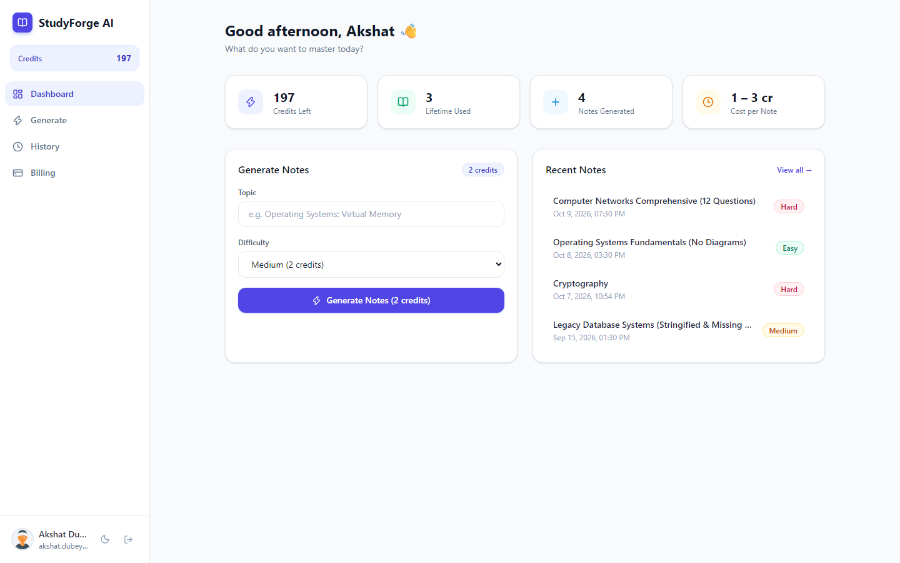
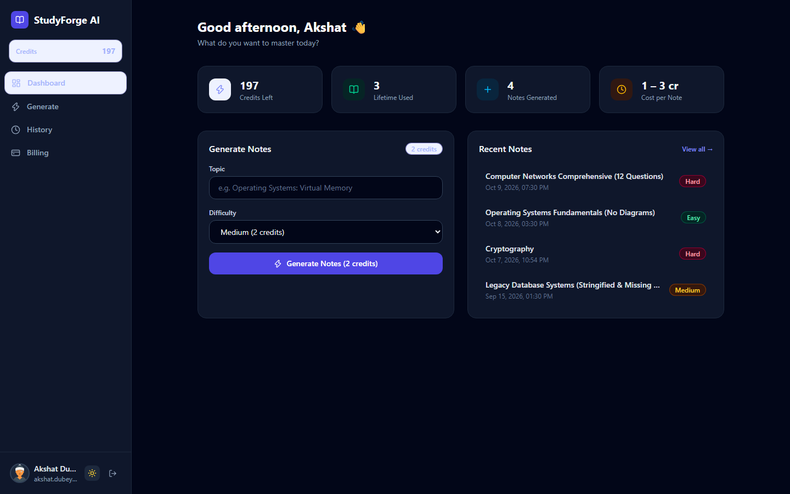
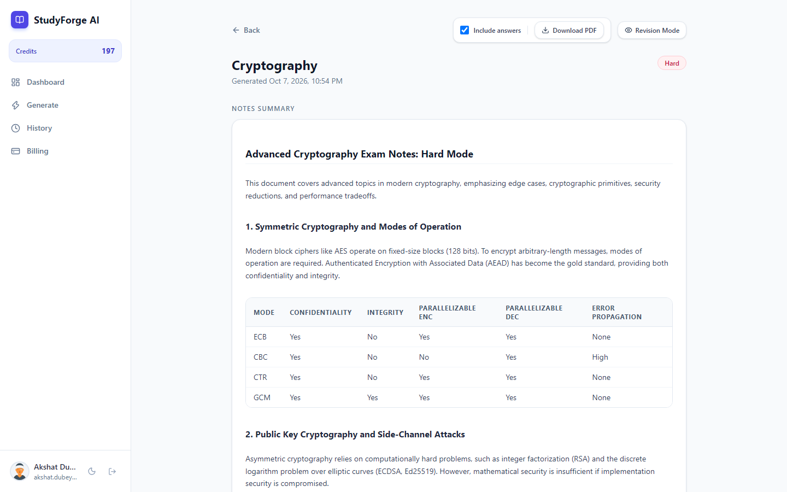
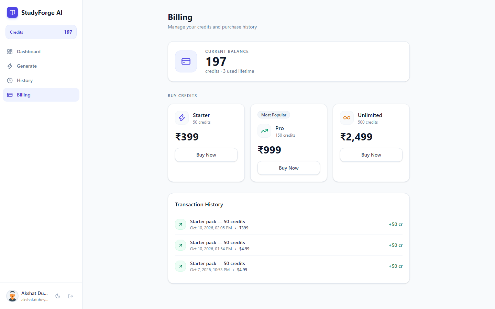

# StudyForge AI

> AI-powered exam revision notes, interactive diagrams, practice questions, and print-optimized PDF exports.

[](https://github.com/placeholder-user/studyforge-ai/actions/workflows/ci.yml)
[](LICENSE)
[](https://www.typescriptlang.org/)
[](https://react.dev/)
[](https://nodejs.org/)

---

## 📌 Overview & Pitch

**StudyForge AI** helps students transform dense topics into structured, high-yield exam revision materials in seconds. Backed by Google Gemini generative AI and asynchronous background processing via BullMQ and Redis, it produces comprehensive study sheets complete with difficulty ratings, structured summaries, key concept breakdowns, interactive diagrams (Mermaid flowcharts, entity relationships, state machines) and charts (Recharts), prioritized practice questions, and high-contrast, print-optimized PDF exports.

---

## 🚀 Live Demo

- **Live Application**: `[YOUR_LIVE_DEMO_URL_HERE]` *(e.g. https://studyforge-ai.vercel.app)*

---

## ✨ Features

- **Asynchronous AI Generation**: Generates notes using Google Gemini, with a configurable model (`GEMINI_MODEL`) and automatic fallback between models, running in an isolated BullMQ background worker with automatic retry and timeout safety.
- **Interactive Visualizations**: Renders dynamic Mermaid diagrams (flowcharts, sequence diagrams, mind maps, entity relationship models) and Recharts metrics (bar, line, and pie charts).
- **Print-Optimized PDF Export**: High-contrast, page-break-aware PDF export (`@media print`) that temporarily switches diagrams to light mode, awaits full SVG rendering, and flattens card chromes.
- **Append-Only Credit Ledger**: Atomic credit reservations, spends, and refunds backed by MongoDB multi-document transactions where user balance is strictly the sum of immutable ledger entries (`balance = sum of ledger delta entries`).
- **Billing & Stripe Integration**: Supports credit package purchases (Starter 50 cr, Pro 150 cr, Unlimited 500 cr in INR ₹) with idempotent Stripe webhook verification.
- **Authentication**: JWT-based authentication using httpOnly access and refresh cookies, with Google OAuth 2.0 integration and automatic dev-mode simulation for local development.
- **Class-Based Dark Mode**: Instant theme switching persisted in `localStorage` and synchronized with system preferences without contrast regressions.

---

## 📸 Screenshots

| Dashboard (Light Mode) | Dashboard (Dark Mode) |
| :---: | :---: |
|  |  |

| Note View & Diagrams | Billing & Credit Packages |
| :---: | :---: |
|  |  |

---

## 🛠️ Tech Stack

### Frontend
- **Framework**: [React 19](https://react.dev/) + [Vite 8](https://vitejs.dev/)
- **Routing**: [React Router DOM v7](https://reactrouter.com/)
- **Styling**: [Tailwind CSS v4](https://tailwindcss.com/)
- **Icons**: [Lucide React](https://lucide.dev/)
- **Diagrams & Charts**: [Mermaid.js v12](https://mermaid.js.org/), [Recharts v3](https://recharts.org/)
- **HTTP Client**: [Axios](https://axios-http.com/)

### Backend
- **Runtime**: [Node.js](https://nodejs.org/) (ES Modules / TypeScript with `tsx`)
- **Web Framework**: [Express 4](https://expressjs.com/) with [Helmet](https://helmetjs.github.io/) & [express-rate-limit](https://github.com/express-rate-limit/express-rate-limit)
- **Database**: [MongoDB](https://www.mongodb.com/) with [Mongoose 8](https://mongoosejs.com/) (Replica Set required for multi-document ACID transactions)
- **Queue & Cache**: [BullMQ 5](https://docs.bullmq.io/) + [Redis](https://redis.io/) (via [ioredis 5](https://github.com/redis/ioredis))
- **AI Engine**: [Google Generative AI SDK](https://www.npmjs.com/package/@google/generative-ai) (`@google/generative-ai`)
- **Payments**: [Stripe Node SDK](https://stripe.com/docs/api)
- **Authentication**: [JSON Web Tokens](https://github.com/auth0/node-jsonwebtoken) (`jsonwebtoken`) in `httpOnly` secure cookies

---

## 📂 Project Structure

```text
studyforge-ai/
├── .github/
│   └── workflows/
│       └── ci.yml               # GitHub Actions CI workflow (build, test, type-check)
├── docs/
│   └── screenshots/             # Application screenshots for documentation
├── frontend/                    # Vite + React 19 Client Application
│   ├── public/                  # Static assets & SVG icons
│   ├── src/
│   │   ├── api/                 # Axios API service clients (auth, billing, notes)
│   │   ├── assets/              # Static branding and vector images
│   │   ├── components/
│   │   │   ├── common/          # Reusable UI primitives (AppLayout, Sidebar, Button, Card, Badge)
│   │   │   └── notes/           # Note viewer, question cards, and DiagramRenderer
│   │   ├── constants/           # Shared package pricing and tiers
│   │   ├── context/             # React context providers (Auth, Credit, Theme, Print)
│   │   ├── hooks/               # Custom React hooks (useAuth, useCredits, useJobStatus, useTheme)
│   │   ├── lib/                 # Utility functions (cn / clsx helper)
│   │   ├── mocks/               # Mock data fixtures and fallback handlers
│   │   ├── pages/               # Route views (Dashboard, Generator, Note, History, Billing, Login)
│   │   ├── types/               # TypeScript data models and interfaces
│   │   ├── App.tsx              # Root component & React Router configuration
│   │   ├── index.css            # Tailwind styles & print CSS (@media print)
│   │   └── main.tsx             # Application DOM entrypoint
│   ├── .env.example             # Frontend environment variables template
│   ├── package.json             # Frontend package configuration and scripts
│   ├── tsconfig.json            # TypeScript configuration
│   └── vite.config.ts           # Vite build and proxy settings
├── backend/                     # Express + BullMQ Server Application
│   ├── src/
│   │   ├── config/              # Database (Mongoose) and Redis client configurations
│   │   ├── middleware/          # Authentication, rate limiting, and request validation
│   │   ├── models/              # Mongoose schemas (User, Note, Job, CreditLedger, Transaction)
│   │   ├── queues/              # BullMQ queue definitions
│   │   ├── routes/              # Express route controllers (auth, billing, jobs, notes)
│   │   ├── schemas/             # Zod input validation schemas
│   │   ├── services/            # Core business logic (credits, gemini, stripe, reconciliation)
│   │   ├── workers/             # BullMQ background job processor (noteWorker)
│   │   ├── app.ts               # Express application middleware setup
│   │   ├── server.ts            # API server bootloader (port 3001)
│   │   └── worker.ts            # Independent worker process entrypoint
│   ├── scripts/                 # Maintenance, verification, and diagnostics scripts
│   ├── tests/                   # Integration test suite (concurrency races, Stripe idempotency)
│   ├── .env.example             # Backend environment variables template
│   ├── package.json             # Backend package configuration and scripts
│   └── tsconfig.json            # Backend TypeScript configuration
├── .gitignore                   # Root git exclusion rules (secrets, dependencies, build output)
├── LICENSE                      # MIT Open Source License
├── package.json                 # Root convenience scripts
└── README.md                    # Project documentation
```

---

## ⚙️ Environment Variables

### Frontend (`frontend/.env`)

| Variable | Required | Default | Description |
| :--- | :---: | :---: | :--- |
| `VITE_API_URL` | No | `http://localhost:3001` | Base URL for the Express backend API in production or local environments |

### Backend (`backend/.env`)

| Variable | Required | Example / Default | Description |
| :--- | :---: | :---: | :--- |
| `PORT` | No | `3001` | Port on which the API server listens |
| `NODE_ENV` | No | `development` | Node environment (`development` \| `production` \| `test`) |
| `FRONTEND_URL` | Yes | `http://localhost:5173` | Allowed frontend URL for CORS and OAuth redirects |
| `MONGODB_URI` | Yes | `mongodb://localhost:27017/studyforge?replicaSet=rs0` | MongoDB connection string (must be a replica set for ACID transactions) |
| `REDIS_URL` | Yes | `redis://localhost:6380` | Redis connection URL for BullMQ queue management |
| `JWT_ACCESS_SECRET` | Yes | `64_byte_hex_string` | Secret key used to sign short-lived access JWT tokens |
| `JWT_REFRESH_SECRET` | Yes | `64_byte_hex_string` | Secret key used to sign long-lived refresh JWT tokens |
| `JWT_ACCESS_EXPIRES_IN` | No | `15m` | Lifetime of the access token |
| `JWT_REFRESH_EXPIRES_IN` | No | `7d` | Lifetime of the refresh token |
| `GOOGLE_CLIENT_ID` | Yes* | `your_client_id.apps.googleusercontent.com` | Google OAuth Client ID (*mock fallback available in dev) |
| `GOOGLE_CLIENT_SECRET` | Yes* | `your_google_client_secret` | Google OAuth Client Secret (*mock fallback available in dev) |
| `GOOGLE_CALLBACK_URL` | Yes | `http://localhost:3001/api/auth/google/callback` | OAuth redirect callback URI |
| `STRIPE_SECRET_KEY` | Yes* | `sk_test_...` | Stripe secret API key for billing checkout (*dev fallback available) |
| `STRIPE_WEBHOOK_SECRET` | Yes* | `whsec_...` | Stripe webhook signing secret for payment events |
| `STRIPE_PRICE_STARTER` | Yes* | `price_...` | Stripe Price ID for Starter package (50 credits) |
| `STRIPE_PRICE_PRO` | Yes* | `price_...` | Stripe Price ID for Pro package (150 credits) |
| `STRIPE_PRICE_UNLIMITED` | Yes* | `price_...` | Stripe Price ID for Unlimited package (500 credits) |
| `GEMINI_API_KEY` | Yes* | `your_gemini_api_key` | Google AI Studio API key for Gemini models |
| `GEMINI_MODEL` | No | `gemini-3.5-flash` | Configurable model identifier for generative notes (falls back dynamically across candidate models) |
| `GEMINI_TIMEOUT_MS` | No | `30000` | Request timeout for Gemini API calls in ms |
| `CREDITS_PER_NOTE` | No | `2` | Base credits required to generate a note (difficulty-scaled: easy = 1, medium = 2, hard = 3) |

---

## 🏃 How to Run Locally

### 1. Prerequisites
- **Node.js**: ≥ 20.x
- **Redis**: Port 6380 (or port 6379 configured in `.env`)
- **MongoDB**: Replica set enabled (Local mongod with `--replSet rs0` or free MongoDB Atlas cluster)

### 2. Installation
Clone the repository and install dependencies in both packages:

```bash
git clone https://github.com/placeholder-user/studyforge-ai.git
cd studyforge-ai

# Install backend dependencies
cd backend && npm install && cd ..

# Install frontend dependencies
cd frontend && npm install && cd ..
```

### 3. Environment Configuration
Copy the sample environment templates and configure required keys:

```bash
# In backend/
cp backend/.env.example backend/.env

# In frontend/
cp frontend/.env.example frontend/.env
```

### 4. Running the Application

You can start each service in separate terminal windows:

#### Terminal 1 — Backend API Server
```bash
cd backend
npm run dev
# Starts API server on http://localhost:3001
```

#### Terminal 2 — BullMQ Asynchronous Worker
```bash
cd backend
npm run worker
# Starts note generation worker listening to Redis queue
```

#### Terminal 3 — Frontend Web App
```bash
cd frontend
npm run dev
# Serves UI on http://localhost:5173
```

*(Alternatively, run `npm run dev:frontend`, `npm run dev:backend`, and `npm run dev:worker` from the repository root).*

---

## 🧪 Testing & Verification

To execute the backend safety-critical test suite (verifying concurrent credit reservation race conditions and Stripe webhook idempotency):

```bash
cd backend
npm test
```

To type-check and build both packages:

```bash
# Build backend
cd backend && npm run build && cd ..

# Build frontend
cd frontend && npm run build && cd ..
```

---

## 👤 Author

**Akshat Dubey**
- Email: [akshat.dubey@studyforge.ai](mailto:akshat.dubey@studyforge.ai)
- GitHub: [@placeholder-user](https://github.com/placeholder-user)
- LinkedIn: `[YOUR_LINKEDIN_URL_HERE]`

---

## 📄 License

This project is licensed under the MIT License - see the [LICENSE](LICENSE) file for details.
